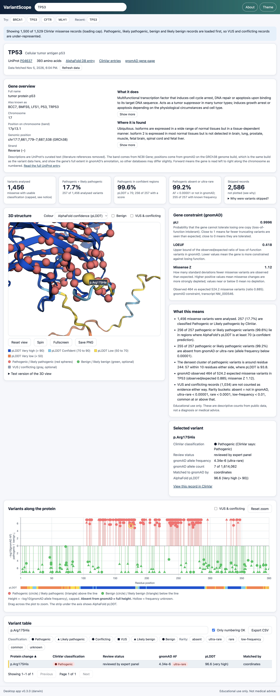
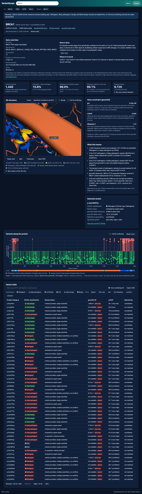

# VariantScope

**Where in a protein do disease-causing changes cluster, is that region confidently structured, and are those changes almost never seen in healthy people?**

VariantScope answers that for any human gene. Type a gene symbol (try `BRCA1`, `TP53`, `CFTR` or `MLH1`) and see, in one view, the AlphaFold 3D structure coloured by prediction confidence, the ClinVar variants mapped onto it, how rare each variant is in gnomAD, and gene-level constraint scores. It ships three ways from one codebase: a desktop app (Windows, macOS, Linux), a web version, and source you can run yourself.

> **Educational use only. Not medical advice.** VariantScope shows public research data. It cannot tell you whether any variant causes disease in any person.



<details>
<summary>More screenshots (dark mode, BRCA1, mobile)</summary>

| BRCA1, dark mode                                               | TP53, mobile (390 px wide)                           |
| -------------------------------------------------------------- | ---------------------------------------------------- |
|  |  |

Also in [`docs/screenshots/`](docs/screenshots/): light and dark desktop, mobile and desktop-app screenshots for both BRCA1 and TP53.

</details>

## Download and try it

- **Desktop app (Windows, macOS, Linux):** [GitHub Releases](https://github.com/reeper316099/VariantScope/releases). The installers are unsigned, so read [Unsigned apps](#unsigned-apps-what-you-will-see) first.
- **Live demo (web):** https://reeper316099.github.io/VariantScope/
- **Source:** `git clone https://github.com/reeper316099/VariantScope.git`, then see [Run it yourself](#run-it-yourself).

The web version talks to the public APIs straight from your browser. If a source cannot be reached from the browser, it says so and suggests the desktop app.

## How to read the screen

- **Gene overview.** Under the gene name: its full name and other names, the chromosome and the band on it (for example 17p13.1), its start and end position on the GRCh38 genome build and which strand it is on, plus a short "What it does" and "Where it is found" taken word for word from UniProt's curated text (literature references removed, with a Show more button for long ones). Anything a source does not provide says "not available", and a source that cannot be reached is named on the card.
- **3D structure.** The ribbon is coloured by AlphaFold's confidence score, pLDDT: dark blue (> 90, very high), light blue (70 to 90, confident), yellow (50 to 70, low), orange (< 50, very low). Red spheres are pathogenic or likely pathogenic ClinVar variants. Benign (green) and VUS (gray) spheres are optional.
- **Plot.** Each lollipop is a variant at its residue. Height is `-log10(gnomAD allele frequency)`, capped, so a tall stem means rare. **Variants not found in gnomAD get the full height.** Pathogenic is above the line, benign below. The strip under the axis is pLDDT again.
- **Table.** Every variant with ClinVar's classification and review status, gnomAD frequency and rarity, pLDDT and how it was matched. Sort, filter, export CSV.
- **Summary cards.** How many variants were analysed, what share are pathogenic, what share of those sit in confidently-predicted regions, and what share are absent or ultra-rare in gnomAD. A "skipped" card explains what was not plotted and why.
- **What this means.** Plain sentences built only from the computed numbers, stating the thresholds used.
- Selecting a variant in the 3D view, the plot or the table highlights it in all three.

## Your saved genes (the home page)

Every gene you open is **saved automatically**, so it opens instantly next time, even with no internet. The home page (click the app name, top left) lists them as cards:

- the gene, protein name, when it was saved, how many variants were analysed, the share that is pathogenic, and how much space it uses;
- **Open** (straight from the saved data, no download), **Refresh** (download the latest data again) and **Delete** (two clicks, so it can't happen by accident);
- sorting by recently opened, name, size or oldest data, and **Delete all**.

Saved data is **never deleted because of its age**. After 7 days it gets an **Out of date** label instead, and the app does _not_ refresh it behind your back: you decide when to press Refresh. If a Refresh fails (for example you are offline), the saved data stays on screen.

Where it is kept: the desktop app stores each gene's responses as files in its data folder (`~/Library/Application Support/VariantScope/api-cache` on macOS, `%APPDATA%\VariantScope\api-cache` on Windows, `~/.config/VariantScope/api-cache` on Linux). The web version keeps them in the browser's `localStorage`, which survives closing the tab but is limited to roughly 5 MB per site, so a very large gene may not be fully saved there. Nothing is ever sent to a server, and the only personal thing stored is which genes you searched; File > Clear cache (desktop) or **Delete all** removes all of it.

### Folders (desktop app only)

In the desktop app you can organise your saved genes into **folders**, like a file manager. The web version does not have folders: its home page stays a flat list.

- **New folder** makes a folder in the one you are looking at, so folders can be nested (up to six levels). The path at the top ("All genes > Cancer > Breast") shows where you are, and each step is a button that takes you back.
- A gene can be in **several folders** at once. Use **Folders...** on a gene card to tick them. A gene in no folder sits at the top level.
- **Move** things with the **Move to...** menu on a folder, or by **dragging** a gene or folder card onto a folder (or onto a step of the path to move it up). Dragging a gene out of the folder you are in moves it, so it leaves that folder.
- A folder is only a label. **Delete folder only** keeps all your genes (its subfolders move up one level). **Delete folder and everything inside** also deletes the saved genes that are in no other folder, and tells you which ones first.
- The folder layout is stored with the home page list in the app's data folder, so no new access was needed: the desktop bridge still has six functions.

## How it works

```text
you type "TP53"
      |
      v
src/ui/search.js --> src/core/pipeline.js   loadGene(): one source failing never blocks the rest
                        1. uniprot.js     gene symbol -> accession + the reference sequence (all numbering)
                        2. at the same time:
                             alphafold.js   structure (PDB) + pLDDT from the B-factor column
                             clinvar.js     missense variants, classification, review status
                             gnomad.js      allele frequencies + gene constraint
                        |
   every request goes through ONE function: src/core/http.js  getJson()
                        |
        +---------------+--------------------------------+
        | Desktop app (Electron)                         | Web version (browser)
        | window.api.fetchJson  --IPC-->  main process   | plain fetch() + localStorage cache
        |   electron/fetcher.js: host allowlist,         |   (saved per gene, memory fallback)
        |   https only, 20 s timeout, 1 retry,           |
        |   25 MB cap, per-host rate limit,              |
        |   saved data on disk, tagged per gene          |
        +---------------+--------------------------------+
                        |
                        v
   parse.js  ->  join.js (ClinVar <-> gnomAD + numbering check)  ->  stats.js
                        |
                        v
   viewer3d.js (3Dmol) . lollipop.js (Chart.js) . table.js . cards.js
   selection.js keeps all three views in sync
```

The adapter is the key design choice. Nothing outside `http.js` knows whether it is running in Electron or a browser. In the desktop app the **main process** does the fetching, which avoids browser CORS limits, lets one place enforce NCBI's 3 requests per second, caches to disk so the app works offline, and means the web page itself never needs network access (its Content-Security-Policy forbids it).

## Data sources

All data comes straight from public APIs. There are no API keys, no paid services and no backend server. Nothing is invented: missing data is shown as "not available".

| Source                                                  | What it provides                                                                                                                                                                  | Endpoint used                                    | Accessed   |
| ------------------------------------------------------- | --------------------------------------------------------------------------------------------------------------------------------------------------------------------------------- | ------------------------------------------------ | ---------- |
| [UniProt](https://www.uniprot.org/)                     | Gene to accession, protein name, the **reference sequence** used for all residue numbers (reviewed human entries only), and the curated Function and Tissue text for the overview | `rest.uniprot.org/uniprotkb/search`              | 2 Nov 2026 |
| [AlphaFold DB](https://alphafold.ebi.ac.uk/)            | Predicted 3D structure and per-residue pLDDT (model version 6 at the time of access, taken from the API, never hard-coded)                                                        | `alphafold.ebi.ac.uk/api/prediction/{accession}` | 2 Nov 2026 |
| [ClinVar](https://www.ncbi.nlm.nih.gov/clinvar/) (NCBI) | Variants with germline classification and review status; also the Gene record for the overview (cytogenetic band, other names)                                                    | NCBI E-utilities `esearch` + `esummary`          | 2 Nov 2026 |
| [gnomAD](https://gnomad.broadinstitute.org/)            | Allele frequencies and gene constraint (dataset `gnomad_r4`, GRCh38); also the gene's name and position for the overview                                                          | `gnomad.broadinstitute.org/api` (GraphQL)        | 2 Nov 2026 |

Every response is shown with when it was fetched (and "cached N days ago" if it came from saved data, with an **Out of date** label after 7 days). The About box lists the exact data versions used for the gene on screen.

## Joining ClinVar to gnomAD, and its limits

This is the hardest part, because the two databases describe the same variant differently.

1. **Coordinates first.** ClinVar gives a genomic position and the changed bases (GRCh38). gnomAD identifies variants as `chromosome-position-ref-alt`. When ClinVar has coordinates, that exact key is used. If gnomAD has no such variant, the variant is reported as **not found in gnomAD** (very rare), with no guessing.
2. **Protein-change fallback, but only when it is safe.** If ClinVar has no coordinates, the protein change (for example `R175H`, with three-letter and one-letter codes and transcript prefixes normalised) is used, **only if exactly one** gnomAD variant has that change. The reason: different DNA changes can give the same amino-acid change, and attaching the wrong one's frequency would be a silent error. When the test data was analysed, this affected 136 BRCA1, 51 TP53 and 48 CFTR variants that have coordinates but no gnomAD match, yet share an amino-acid change with a _different_ gnomAD variant.
3. **Honest outcomes.** Every joined row records `matchedBy`: `coordinates`, `protein-change` or none. "Not found in gnomAD" is never mixed up with "the gnomAD query failed" (the latter gives rarity `unknown`). A variant gnomAD lists with zero observed alleles counts as not found.
4. **Frequencies** use gnomAD's _joint_ exome and genome counts, which already handle samples that appear in both.

**Numbering check.** ClinVar and gnomAD number residues on a specific transcript (often MANE Select), while UniProt's canonical protein may differ. For every variant the app checks that the reference amino acid really is at that position in the UniProt sequence. Mismatching variants are never drawn on the structure and are listed separately in the table, and a prominent warning appears if fewer than 95% match. In testing on 2 Nov 2026 the match rate was **100%** for BRCA1, TP53, CFTR and MLH1.

**Limits to keep in mind**

- Only single-residue **missense** changes are plotted. Frameshift, nonsense, splice, in-frame and non-coding records are counted in the "skipped" card but not drawn.
- For large genes only **1,500** variants are loaded (pathogenic, likely pathogenic, benign and likely benign first), so VUS and conflicting records are under-represented. The app shows how many exist and how many were loaded.
- ClinVar labels are mapped to six classes: "Pathogenic/Likely pathogenic" shows as Pathogenic, "Benign/Likely benign" as Benign. The original ClinVar wording is always shown beside it. Records without a usable germline classification (for example "not provided" or "drug response") are not plotted.
- ClinVar review quality varies, a VUS means "variant of uncertain significance", and AlphaFold predicts structure (a prediction, not experimental proof). gnomAD reflects the people sampled, not everyone.

## Rarity thresholds

Defined at the top of [`src/core/stats.js`](src/core/stats.js) and shown in the app.

| Bucket        | Rule (gnomAD allele frequency, AF)                                            |
| ------------- | ----------------------------------------------------------------------------- |
| absent        | not found in gnomAD (or zero observed alleles)                                |
| ultra-rare    | AF < 1e-5                                                                     |
| rare          | AF < 1e-4                                                                     |
| low-frequency | AF < 1e-2                                                                     |
| common        | AF >= 1e-2                                                                    |
| unknown       | frequency could not be determined (gnomAD failed, or the match was ambiguous) |

Other thresholds: a region counts as "confidently predicted" at pLDDT >= 70; the density colouring counts pathogenic variants within 10 residues either side; numbering is flagged below 95% matching.

## Unsigned apps: what you will see

The installers are **not code-signed or notarized**. That needs paid developer accounts (Apple Developer Program, a Windows code-signing certificate), which this project does not have. The apps are safe to open if you downloaded them from this repository's Releases page, but your operating system will warn you the first time. You can check a download against `SHA256SUMS.txt` on the same release page.

### Windows (SmartScreen)

You will see **"Windows protected your PC"** with **Publisher: Unknown publisher**.

1. Click **More info**.
2. Click **Run anyway**.

This applies to both the installer (`VariantScope-Setup-…-win-x64.exe`) and the portable app (`VariantScope-Portable-…-win-x64.exe`).

### macOS (Gatekeeper)

The app has an ad-hoc signature (so it is internally consistent) but no Apple certificate and no notarization. The first time you open it, macOS says it cannot verify the app (the wording varies by macOS version, for example "Apple could not verify VariantScope is free of malware").

- **macOS 15 (Sequoia) and newer:** double-click the app, click **Done**, then open **System Settings → Privacy & Security**, scroll down to the message about VariantScope and click **Open Anyway**, then confirm.
- **macOS 14 and older:** Control-click (or right-click) the app, choose **Open**, then click **Open** in the dialog.
- **Or from the Terminal**, after dragging the app to Applications:

  ```bash
  xattr -dr com.apple.quarantine /Applications/VariantScope.app
  ```

Use `…-mac-arm64.dmg` on Apple Silicon (M1 and newer) and `…-mac-x64.dmg` on Intel Macs.

### Linux

- **AppImage:** make it executable and run it:

  ```bash
  chmod +x VariantScope-*-linux-x64.AppImage
  ./VariantScope-*-linux-x64.AppImage
  ```

  On newer Ubuntu you may need FUSE: `sudo apt install libfuse2t64` (older releases: `libfuse2`).

- **.deb:** `sudo apt install ./VariantScope-*-linux-x64.deb`. On Ubuntu 24.04 the .deb is the more reliable choice, because the AppImage's sandbox can be blocked by the system's user-namespace restrictions. Please do not "fix" that with `--no-sandbox`: it turns off a security feature.

### Verify a download (optional)

Each release has a `SHA256SUMS.txt`. Download it next to the installers, then:

```bash
shasum -a 256 -c SHA256SUMS.txt --ignore-missing      # macOS and Linux
```

```powershell
Get-FileHash .\VariantScope-Setup-*.exe -Algorithm SHA256   # Windows: compare with the file
```

## Run it yourself

You need [Node.js](https://nodejs.org/) 22.13 or newer.

```bash
git clone https://github.com/reeper316099/VariantScope.git
cd VariantScope
npm ci
```

**In the browser (development):**

```bash
npm run dev
```

Open http://localhost:5173.

**As a desktop app (development):**

```bash
npm run dev:electron
```

**Build the web version:**

```bash
npm run build:web
```

The output is in `dist/web`. For a GitHub Pages project site use `VITE_BASE=/VariantScope/ npm run build:web`.

**Tests**

```bash
npm test             # 333 unit tests (parsing, join, stats, table logic, CSV, cache, contrast...)
npm run lint
npm run test:e2e     # end-to-end tests in a real browser and in Electron
```

The end-to-end tests call the **live public APIs**, so they need internet and take several minutes. Locally they use your installed Google Chrome (headless) and run the desktop app invisibly. On CI, set `CI=1` and run `npx playwright install chromium` first.

**Build installers for your own system**

```bash
npm run dist
```

Installers appear in `release/`. Requirements: the macOS installers must be built on a Mac, and the Windows ones on Windows (or use the release workflow). If your project folder is inside **iCloud Drive** (for example `~/Desktop` with sync on), macOS code signing can fail with "resource fork, Finder information, or similar detritus not allowed", because iCloud keeps adding file metadata. Build outside the synced folder:

```bash
npx electron-builder --publish never -c.directories.output=/tmp/variantscope-release
```

## What has been tested

"Tested locally" means it was run on the developer's Mac (Apple Silicon). Anything else is verified only when GitHub Actions runs it, and is marked clearly until a real run passes. Last updated 2 Nov 2026.

| Target                                                                                                                                                          | Status                                                                                                        |
| --------------------------------------------------------------------------------------------------------------------------------------------------------------- | ------------------------------------------------------------------------------------------------------------- |
| Unit tests (333) and lint                                                                                                                                       | Tested locally: pass. About 97% statement coverage of `src/core/`                                             |
| Web version in headless Chrome, live APIs (73 end-to-end tests: five genes, 3D picking, filters, exports, blocked sources, slow network, mobile, dark mode)     | Tested locally: pass                                                                                          |
| Desktop app in development on macOS (34 end-to-end tests: security checks, IPC search, menus, saved genes, the home page and folders, disk cache, offline mode) | Tested locally: pass                                                                                          |
| **macOS Apple Silicon (arm64) packaged app**                                                                                                                    | Tested locally: built, ad-hoc signature verified, DMG mounted, packaged app launched and loaded a gene        |
| Real fullscreen and native Save dialogs in the desktop app                                                                                                      | **Not automated** (they would take over the screen); check by hand                                            |
| macOS Intel (x64) `.dmg`                                                                                                                                        | **UNTESTED LOCALLY, verified only by CI**                                                                     |
| Windows installer and portable `.exe`                                                                                                                           | **UNTESTED LOCALLY, verified only by CI**                                                                     |
| Linux `.AppImage` and `.deb`                                                                                                                                    | **UNTESTED LOCALLY, verified only by CI**                                                                     |
| GitHub Pages deployment                                                                                                                                         | Subpath build tested locally in a browser; the deployment itself is **UNTESTED LOCALLY, verified only by CI** |
| Release workflow (tag to published release, `SHA256SUMS.txt`)                                                                                                   | **UNTESTED LOCALLY, verified only by CI**                                                                     |

## Security notes

- **Desktop app:** `contextIsolation: true`, `nodeIntegration: false`, `sandbox: true`. The page cannot use Node.js. A strict Content-Security-Policy blocks inline scripts, `eval`, and any direct network access from the page. The shipped bundle contains no `eval` (a build step removes the one that 3Dmol contains and fails the build if that code ever changes).
- **Only six things cross the bridge:** `fetchJson`, `saveFile`, `openExternal`, `getAppInfo`, and for the home page `listCache` and `deleteCache`. Each validates its arguments, and the main process re-checks every call and that it came from the app's own page. `deleteCache` accepts only `"all"` or a short list of safe gene tags (capital letters, digits and hyphens), and can only touch files inside the app's own `api-cache` folder.
- **Network:** the main process fetches only from four allowlisted hosts (UniProt, AlphaFold DB, NCBI, gnomAD), https only, no redirects, with a timeout, a size cap and per-host rate limits. Electron's own HTTP cache is switched off so the saved data is the only cache.
- **Navigation and windows:** navigating away from the app and opening new windows are blocked. Links open in the system browser only if they are https and on a short allowlist. Permission requests are denied, except fullscreen for the app's own page.
- **Data handling:** text from the APIs is only ever written as plain text (never as HTML), CSV export neutralises spreadsheet formulas, and no secrets or API keys exist.

## Data attribution

VariantScope displays data from four public resources. Please cite them if you use what you see here in your own work.

- **UniProt.** Licensed under [Creative Commons Attribution 4.0 (CC BY 4.0)](https://creativecommons.org/licenses/by/4.0/) for the copyrightable parts of the database (UniProt's license statement). Cite: The UniProt Consortium. UniProt: the Universal Protein Knowledgebase in 2025. _Nucleic Acids Research_ 53(D1):D609-D617 (2025). [doi:10.1093/nar/gkae1010](https://doi.org/10.1093/nar/gkae1010).
- **AlphaFold Protein Structure Database.** Provided by DeepMind and EMBL-EBI under CC BY 4.0 (the database's license and disclaimer page points to it). This covers the database; the AlphaFold model code and weights have separate terms and are not used here. Cite: Jumper, J. et al. Highly accurate protein structure prediction with AlphaFold. _Nature_ 596:583-589 (2021). [doi:10.1038/s41586-021-03819-2](https://doi.org/10.1038/s41586-021-03819-2); and Varadi, M. et al. AlphaFold Protein Structure Database in 2024: providing structure coverage for over 214 million protein sequences. _Nucleic Acids Research_ 52(D1):D368-D375 (2024). [doi:10.1093/nar/gkad1011](https://doi.org/10.1093/nar/gkad1011).
- **ClinVar** (NCBI, National Library of Medicine). A freely available public archive of variant interpretations submitted by many laboratories; the 2018 ClinVar paper states that the work is in the public domain in the US. Submitters' classifications can differ, so always read the review status. NCBI's own data-usage policy page could not be retrieved while this was written (it sits behind a browser check), so please read it at <https://www.ncbi.nlm.nih.gov/home/about/policies/>. Cite: Landrum, M.J. et al. ClinVar: improving access to variant interpretations and supporting evidence. _Nucleic Acids Research_ 46(D1):D1062-D1067 (2018). [doi:10.1093/nar/gkx1153](https://doi.org/10.1093/nar/gkx1153).
- **gnomAD** (Genome Aggregation Database, Broad Institute). The AWS Open Data Registry, which hosts the data, describes it as released "for the benefit of the wider scientific community without restriction on use" (v4.1, GRCh38) and lists the license as MIT. gnomAD's own terms page could not be retrieved while this was written, so please confirm at <https://gnomad.broadinstitute.org/about>. Please cite the gnomAD papers: Karczewski, K.J. et al. The mutational constraint spectrum quantified from variation in 141,456 humans. _Nature_ 581:434-443 (2020). [doi:10.1038/s41586-020-2308-7](https://doi.org/10.1038/s41586-020-2308-7); and, for the v4 constraint metrics, Chen, S. et al. A genomic mutational constraint map using variation in 76,156 human genomes. _Nature_ 625:92-100 (2024). [doi:10.1038/s41586-023-06045-0](https://doi.org/10.1038/s41586-023-06045-0). Check gnomAD's current citation guidance for the exact papers it asks for.

Bundled open-source libraries: [3Dmol.js](https://3dmol.csb.pitt.edu/) (BSD-3-Clause), [Chart.js](https://www.chartjs.org/) (MIT), [Electron](https://www.electronjs.org/) (MIT) and [Vite](https://vite.dev/) (MIT), among others in `package.json`. Please check each project's own license for details.

## Stretch goals

Ranked by impact for effort, best first.

1. **Shareable gene URLs** (impact: medium, effort: small). Put the gene and the selected variant in the address (`#/TP53/R175H`) so a view can be bookmarked and shared, and so the browser's back button works.
2. **"Load all variants" for big genes** (impact: high, effort: small to medium). Stream the rest of ClinVar after the first 1,500 so VUS and conflicting records are no longer under-represented, with progress and a cancel button.
3. **Code signing, notarization and auto-update** (impact: high, effort: medium, plus yearly fees). Remove the first-launch warnings and add `electron-updater` so installed apps update themselves.
4. **PAE overlay** (impact: medium, effort: medium). AlphaFold also publishes predicted aligned error (how confident it is about the relative position of two parts), which would show whether a clustered region is a rigid unit. The API already returns the PAE URLs.
5. **gnomAD ancestry breakdown** (impact: medium, effort: medium). Show allele frequency per genetic ancestry group for the selected variant, to separate "rare everywhere" from "common in one group".

Further ideas: compare two genes side by side, and a TCGA overlay of somatic variants in tumours.

## What I learned

> **TODO (for the author):** write this section in your own words before sharing the repo. Good things to cover: what surprised you about the data, the bug that was hardest to find, and what you would do differently. [`INTERVIEW.md`](INTERVIEW.md) has talking points to start from.

## License

The code is released under the [MIT License](LICENSE). The data shown in the app has its own terms, described under [Data attribution](#data-attribution).
