# VariantScope architecture

How the app is put together, written so you can explain it. Educational use only; not medical advice.

## The big idea

One codebase ships three ways:

| Way                         | What runs                             | Where the network calls happen                     |
| --------------------------- | ------------------------------------- | -------------------------------------------------- |
| Desktop app (Electron)      | The page inside a locked-down window  | The **main process** (a separate, trusted program) |
| Web version (GitHub Pages)  | The same page in a normal browser tab | The **page itself**, with plain `fetch`            |
| From source (`npm run dev`) | The same page on a local dev server   | The page itself                                    |

The page code does not care which one it is in. It calls one function, `getJson` (`src/core/http.js`), and that function picks the path.

## Folder map

```text
src/
  index.html          the single page (search box, home page, results panels)
  main.js             wires everything together (search, home page, folders, menu events)
  core/               logic with no DOM: fetching, parsing, joining, stats, saving
  ui/                 drawing code: 3D viewer, plot, table, cards, home page, dialogs
  styles/             tokens.css (colours), components.css, layout
electron/
  main.js             creates the window, security rules, IPC handlers
  preload.cjs         the only bridge between the page and the main process
  fetcher.js          network calls for the page (allowlist, timeout, rate limit, size cap)
  allowlist.js        the four API hosts, https only
  disk-cache.js       saved responses as files, one tag per gene
  csp.js, menu.js     the Content-Security-Policy and the application menu
tests/
  unit/               Vitest (logic, no browser)
  e2e/                Playwright (web in Chrome, desktop through Electron)
scripts/              icons, ad-hoc signing, dev launcher, the test timeout watchdog
.github/workflows/    ci.yml, pages.yml, release.yml
docs/                 this file, PUBLISHING.md, screenshots
```

The rule of thumb: `src/core` is plain functions that can be tested without a browser, and `src/ui` only draws what `core` gives it.

## What happens when you search a gene

```text
type "TP53"  ->  loadGene()  (src/core/pipeline.js)
   1. UniProt   gene symbol -> protein accession, sequence, name   (required)
   2. in parallel, each allowed to fail on its own:
        AlphaFold   structure file URL + confidence (pLDDT)
        ClinVar     variants (via NCBI E-utilities), up to 1,500
        gnomAD      allele frequencies + constraint scores (GraphQL)
        Overview    UniProt function/tissue text + NCBI Gene band + gnomAD position
   3. parse.js     turns each raw response into plain objects
   4. join.js      matches ClinVar variants to gnomAD variants
   5. stats.js     rarity buckets, density, summary numbers
   -> one result object  ->  panels draw it  ->  recordGene() saves it to the home page
```

Key decisions:

- **UniProt is required** because it gives the reference sequence that all residue numbers are checked against. If it fails the search fails.
- **The other sources can fail separately.** A failed source shows a warning on its own panel and the rest keeps working. Missing values say "not available"; nothing is estimated.
- **The join uses genomic coordinates first.** A protein-change fallback is used only when ClinVar has no coordinates and exactly one gnomAD variant has that change. If gnomAD could not be reached the rarity is `unknown`, never `absent`.
- **Numbering check.** Each variant's reference amino acid is compared with the UniProt sequence. Mismatches are never drawn, and a warning appears if fewer than 95% match.

## The gene overview

`src/core/overview.js` builds the "Gene overview" card from three requests, each allowed to fail on its own:

- **UniProt** (by accession): the curated Function and Tissue specificity text, and the NCBI Gene ID. Literature references like `(PubMed:123)` are removed; other notes such as "(By similarity)" are kept.
- **NCBI Gene** (by that ID, through ClinVar's rate-limited NCBI queue): the cytogenetic band (`17p13.1`) and other names.
- **gnomAD** (by symbol): full name, chromosome, start, end and strand on GRCh38.

It is a separate request from the main UniProt lookup on purpose, so genes saved before it existed still open offline. A part that fails leaves its fields empty and is listed on the card. The overview only throws (and the panel shows an error with Retry) if all three fail. Text is shown exactly as the source gives it; the app writes none of it.

## The single network function

`getJson(url, options)` in `src/core/http.js`:

- **Desktop:** calls `window.api.fetchJson`, which goes over IPC to `electron/fetcher.js`. That checks the allowlist (four hosts, https only), applies a 20 second timeout, one retry, a 25 MB size cap and a per-host rate limit (NCBI 340 ms), refuses redirects, and saves the response to disk.
- **Browser:** plain `fetch`, plus a memory map and `localStorage` as the saved copy.

Both paths tag the saved copy with the gene ("group"). That tag is how the home page can size and delete one gene's data without opening files.

## Saved data and freshness

- Saved data **never expires**. It is shown at any age.
- After **7 days** it is labelled **Out of date** and offers **Refresh**. The app never refreshes behind your back.
- Refresh calls the same code with `noCache`, so it downloads again and replaces the saved copy.
- A failed refresh keeps the saved data on screen.

Where it lives:

| Data           | Desktop                                                       | Web                                    |
| -------------- | ------------------------------------------------------------- | -------------------------------------- |
| API responses  | files `api-cache/<GENE>~<hash>.json` in the app data folder   | `localStorage`, keys `http:<GENE>:...` |
| Home page list | `localStorage` key `library` (in the app's own Local Storage) | same                                   |
| Folder layout  | `localStorage` key `folders`                                  | **not used**                           |

The web version is limited to about 5 MB per site by the browser.

## The home page and folders

- `src/core/library.js`: the list of saved genes (summary per gene, sorting).
- `src/core/folders.js`: the folder layout. Pure functions only: each change returns a new state and never edits the old one.
- `src/core/folderStore.js`: loads and saves the layout. Everything read from storage goes through `sanitizeFolders`, which drops bad ids, loops and anything too deep.
- `src/ui/home.js` and `src/ui/dialog.js`: cards, breadcrumbs, dialogs, drag and drop.
- `src/main.js` applies a change, saves it and redraws.

Folder rules:

- A folder is **only a label**. No gene data is moved or copied.
- A gene can be in **several folders**; in none means the top level.
- Nesting is limited to 6 levels. A folder can't go inside itself or its own subfolders. Sibling names are unique.
- **Desktop only.** `main.js` returns no layout unless `isElectron()` is true, so the web page shows the flat list and never reads or writes folder data.
- Deleting a folder keeps genes by default. "Delete folder and everything inside" deletes only genes that are in no other folder, and lists them first.

## Desktop security

| Setting                                                             | Why                                                               |
| ------------------------------------------------------------------- | ----------------------------------------------------------------- |
| `contextIsolation: true`, `nodeIntegration: false`, `sandbox: true` | The page can't reach Node.js or the file system                   |
| Strict Content-Security-Policy, `connect-src 'none'`                | The page can't make network calls; only the main process can      |
| `app://` custom protocol                                            | Files load from the app, not from `file://`                       |
| Navigation and new windows blocked                                  | Only allowlisted https links open, and only in the system browser |
| Permissions denied (except fullscreen for the app's own page)       | No camera, location, notifications                                |
| No `eval`                                                           | A build plugin removes the single `eval` inside 3Dmol             |

The preload script exposes exactly **six** functions: `fetchJson`, `saveFile`, `openExternal`, `getAppInfo`, `listCache`, `deleteCache`. Each validates its arguments, and the main process re-checks every call and that it came from the app's own page. `deleteCache` accepts only `"all"` or a short list of safe gene tags and can only touch the `api-cache` folder.

## The page: panels and selection

- Six panels (stats, viewer, constraint, meaning, plot, table) each have a state: loading, ready, empty or error.
- A small selection store keeps the 3D view, the lollipop plot and the table in sync: select a variant in one and the other two follow.
- 3Dmol (3D) and Chart.js (plot) are bundled from npm, with no CDN. 3Dmol loads lazily when a structure is first shown.
- Text always goes in with `textContent`, never `innerHTML`, so API data can't inject markup. No inline styles are written (the CSP forbids them).

## Build and release

- **Vite** builds three outputs: `dist/web` (Pages), `dist/electron-renderer` (the desktop page) and `dist/e2e` (adds test-only hooks, never shipped).
- **electron-builder** packages the installers: macOS dmg, Windows installer and portable, Linux AppImage and deb. They are **unsigned**.
- **ci.yml:** lint and unit tests, sharded browser tests, a packaging smoke test on three operating systems, and a best-effort desktop test on Linux.
- **pages.yml:** builds the web version and deploys it to GitHub Pages.
- **release.yml:** pushing a tag like `v0.3.0` builds the installers on three operating systems and publishes a GitHub Release. The tag is the single source of the version. Never create the release by hand on GitHub's website.

## Testing

- **Unit (Vitest):** logic in `src/core` and `electron/`, including the join, stats, cache, freshness, library and folders.
- **Browser (Playwright):** the web build in headless Chrome against the live APIs.
- **Desktop (Playwright + Electron):** security checks, search over IPC, menus, saved genes, folders, offline mode. It runs invisibly with a throwaway data folder, under `scripts/with-timeout.mjs` so a stuck run is killed.

Test-only hooks (`window.__vsTest`, `data-selected-*` attributes) exist only in the `--mode e2e` build.

## Known limits

- Only single-residue missense variants are plotted; other ClinVar records are counted but not drawn.
- Large genes load at most 1,500 ClinVar variants (pathogenic and benign first), so VUS and conflicting records are under-represented. The app says so on screen.
- Installers are unsigned, so Windows and macOS show a warning the first time.
- Windows, Linux and macOS Intel builds are verified by GitHub Actions only.
- The web version's storage is about 5 MB per site.

## Diagram

```mermaid
%% Generated by https://gitdiagram.com/reeper316099/variantscope
flowchart TD

subgraph group_analysis["Gene data analysis"]
  node_pipeline["Gene loading<br/>[pipeline.js]"]
  node_uniprot["UniProt lookup<br/>[uniprot.js]"]
  node_alphafold["AlphaFold data<br/>[alphafold.js]"]
  node_clinvar["ClinVar variants<br/>[clinvar.js]"]
  node_gnomad["gnomAD data<br/>[gnomad.js]"]
  node_parse["Response parsing<br/>[parse.js]"]
  node_join["Variant matching<br/>[join.js]"]
  node_stats["Variant statistics<br/>[stats.js]"]
  node_summary["Summary text<br/>[summaryText.js]"]
  node_tablemodel["Table model<br/>[tableModel.js]"]
end

subgraph group_transport["Transport and cache"]
  node_http["HTTP adapter<br/>[http.js]"]
  node_browsercache[("Browser cache<br/>[cache.js]")]
  node_freshness["Freshness rules<br/>[freshness.js]"]
end

subgraph group_results["Results interface"]
  node_search["Gene search<br/>[search.js]"]
  node_app["App orchestration<br/>[main.js]"]
  node_viewer["3D structure view<br/>[viewer3d.js]"]
  node_plot["Variant plot<br/>[lollipop.js]"]
  node_table["Variant table<br/>[table.js]"]
  node_cards["Summary cards<br/>[cards.js]"]
  node_selection["Shared selection<br/>[selection.js]"]
  node_csv["CSV export<br/>[csv.js]"]
end

subgraph group_library["Saved gene library"]
  node_library["Saved gene library<br/>[library.js]"]
  node_home["Home and folders<br/>[home.js]"]
  node_folders["Folder operations<br/>[folders.js]"]
  node_folderstore["Folder persistence<br/>[folderStore.js]"]
end

subgraph group_desktop["Desktop integration"]
  node_electronbridge["Electron bridge<br/>[preload.cjs]"]
  node_mainprocess["Electron main process<br/>[main.js]"]
  node_fetcher["Secure fetcher<br/>[fetcher.js]"]
  node_allowlist["API allowlist<br/>[allowlist.js]"]
  node_diskcache[("Disk API cache<br/>[disk-cache.js]")]
end

node_user(("Researcher"))
node_externalapis{{"Public data APIs"}}

node_user -->|"enters gene"| node_search
node_search -->|"starts load"| node_pipeline
node_app -->|"loads gene"| node_pipeline
node_pipeline -->|"resolves first"| node_uniprot
node_pipeline -->|"requests data"| node_alphafold
node_pipeline -->|"requests data"| node_clinvar
node_pipeline -->|"requests data"| node_gnomad
node_pipeline -->|"joins results"| node_join
node_pipeline -->|"summarizes variants"| node_stats
node_clinvar -->|"parses responses"| node_parse
node_join -->|"uses parsed data"| node_parse
node_join -->|"computes rarity"| node_stats
node_alphafold -->|"requests JSON"| node_http
node_uniprot -->|"requests JSON"| node_http
node_pipeline -.->|"provides summary"| node_summary
node_pipeline -.->|"provides variants"| node_tablemodel
node_http -->|"reads and writes"| node_browsercache
node_http -->|"fetches via IPC"| node_electronbridge
node_electronbridge -.->|"dispatches IPC"| node_mainprocess
node_mainprocess -->|"uses fetch service"| node_fetcher
node_fetcher -->|"checks hosts"| node_allowlist
node_fetcher -->|"caches responses"| node_diskcache
node_fetcher -->|"fetches HTTPS"| node_externalapis
node_http -->|"browser requests"| node_externalapis
node_app -->|"renders structure"| node_viewer
node_app -->|"renders plot"| node_plot
node_app -->|"renders table"| node_table
node_app -->|"renders summaries"| node_cards
node_selection -->|"synchronizes selection"| node_viewer
node_selection -->|"synchronizes selection"| node_plot
node_selection -->|"synchronizes selection"| node_table
node_app -->|"exports rows"| node_csv
node_app -->|"loads saved genes"| node_library
node_app -->|"renders home"| node_home
node_home -->|"manages folders"| node_folders
node_home -.->|"persists layout"| node_folderstore
node_app -.->|"shows age status"| node_freshness

click node_search "https://github.com/reeper316099/variantscope/blob/main/src/ui/search.js"
click node_app "https://github.com/reeper316099/variantscope/blob/main/src/main.js"
click node_pipeline "https://github.com/reeper316099/variantscope/blob/main/src/core/pipeline.js"
click node_uniprot "https://github.com/reeper316099/variantscope/blob/main/src/core/uniprot.js"
click node_alphafold "https://github.com/reeper316099/variantscope/blob/main/src/core/alphafold.js"
click node_clinvar "https://github.com/reeper316099/variantscope/blob/main/src/core/clinvar.js"
click node_gnomad "https://github.com/reeper316099/variantscope/blob/main/src/core/gnomad.js"
click node_parse "https://github.com/reeper316099/variantscope/blob/main/src/core/parse.js"
click node_join "https://github.com/reeper316099/variantscope/blob/main/src/core/join.js"
click node_stats "https://github.com/reeper316099/variantscope/blob/main/src/core/stats.js"
click node_summary "https://github.com/reeper316099/variantscope/blob/main/src/core/summaryText.js"
click node_tablemodel "https://github.com/reeper316099/variantscope/blob/main/src/core/tableModel.js"
click node_http "https://github.com/reeper316099/variantscope/blob/main/src/core/http.js"
click node_browsercache "https://github.com/reeper316099/variantscope/blob/main/src/core/cache.js"
click node_freshness "https://github.com/reeper316099/variantscope/blob/main/src/core/freshness.js"
click node_electronbridge "https://github.com/reeper316099/variantscope/blob/main/electron/preload.cjs"
click node_mainprocess "https://github.com/reeper316099/variantscope/blob/main/electron/main.js"
click node_fetcher "https://github.com/reeper316099/variantscope/blob/main/electron/fetcher.js"
click node_allowlist "https://github.com/reeper316099/variantscope/blob/main/electron/allowlist.js"
click node_diskcache "https://github.com/reeper316099/variantscope/blob/main/electron/disk-cache.js"
click node_viewer "https://github.com/reeper316099/variantscope/blob/main/src/ui/viewer3d.js"
click node_plot "https://github.com/reeper316099/variantscope/blob/main/src/ui/lollipop.js"
click node_table "https://github.com/reeper316099/variantscope/blob/main/src/ui/table.js"
click node_cards "https://github.com/reeper316099/variantscope/blob/main/src/ui/cards.js"
click node_selection "https://github.com/reeper316099/variantscope/blob/main/src/ui/selection.js"
click node_library "https://github.com/reeper316099/variantscope/blob/main/src/core/library.js"
click node_home "https://github.com/reeper316099/variantscope/blob/main/src/ui/home.js"
click node_folders "https://github.com/reeper316099/variantscope/blob/main/src/core/folders.js"
click node_folderstore "https://github.com/reeper316099/variantscope/blob/main/src/core/folderStore.js"
click node_csv "https://github.com/reeper316099/variantscope/blob/main/src/core/csv.js"

classDef toneNeutral fill:#f8fafc,stroke:#334155,stroke-width:1.5px,color:#0f172a
classDef toneBlue fill:#dbeafe,stroke:#2563eb,stroke-width:1.5px,color:#172554
classDef toneAmber fill:#fef3c7,stroke:#d97706,stroke-width:1.5px,color:#78350f
classDef toneMint fill:#dcfce7,stroke:#16a34a,stroke-width:1.5px,color:#14532d
classDef toneRose fill:#ffe4e6,stroke:#e11d48,stroke-width:1.5px,color:#881337
classDef toneIndigo fill:#e0e7ff,stroke:#4f46e5,stroke-width:1.5px,color:#312e81
classDef toneTeal fill:#ccfbf1,stroke:#0f766e,stroke-width:1.5px,color:#134e4a
class node_pipeline,node_uniprot,node_alphafold,node_clinvar,node_gnomad,node_parse,node_join,node_stats,node_summary,node_tablemodel toneBlue
class node_http,node_browsercache,node_freshness toneAmber
class node_search,node_app,node_viewer,node_plot,node_table,node_cards,node_selection,node_csv,node_externalapis toneMint
class node_library,node_home,node_folders,node_folderstore toneRose
class node_electronbridge,node_mainprocess,node_fetcher,node_allowlist,node_diskcache,node_user toneIndigo
```


